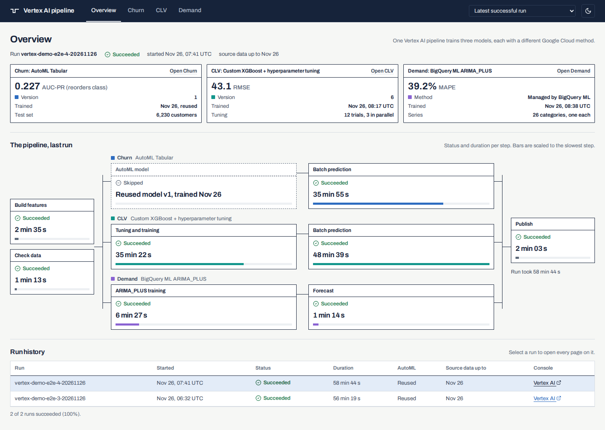
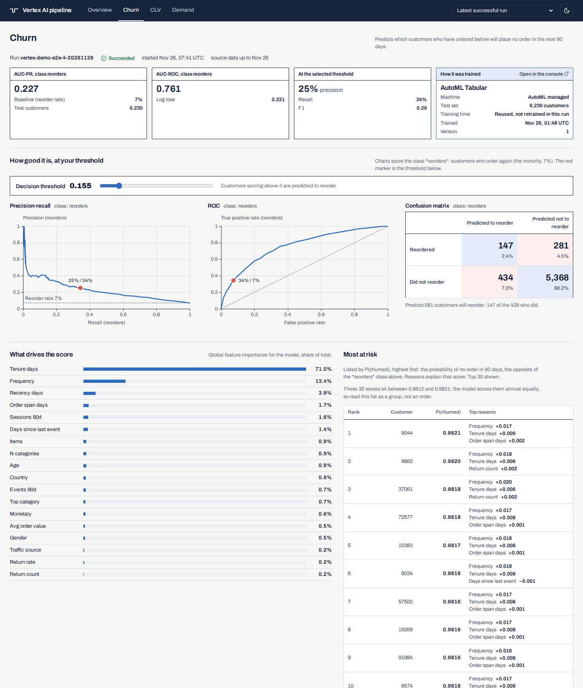
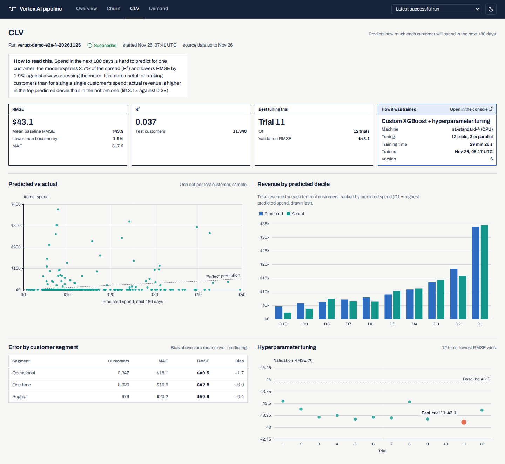
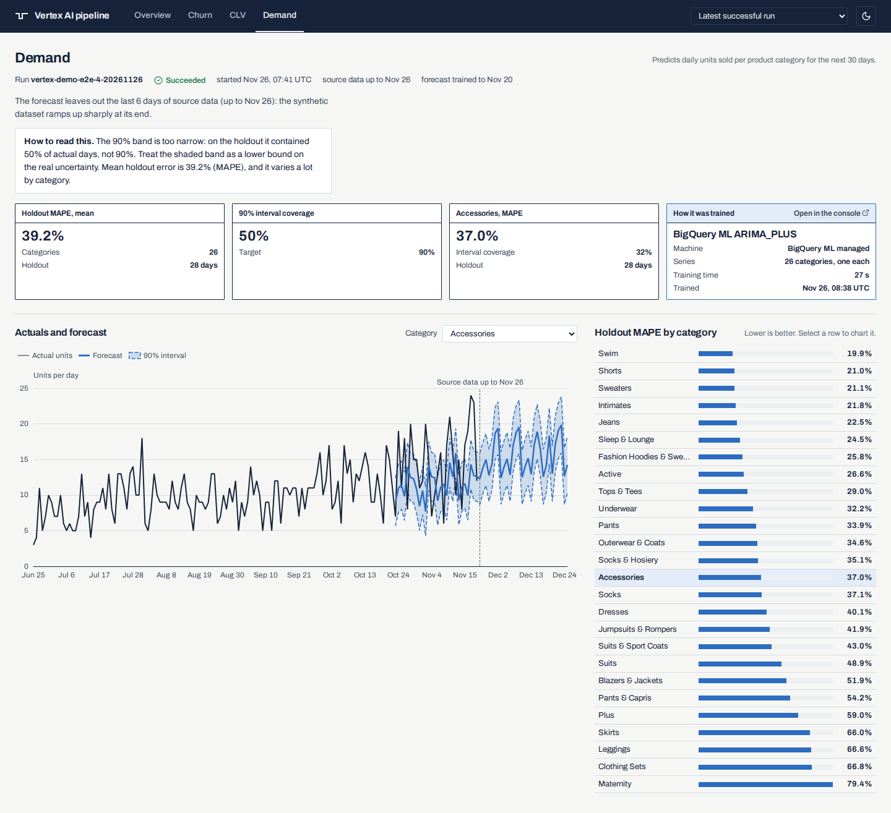

# Vertex AI Pipelines demo

One Vertex AI pipeline trains three predictive models on `bigquery-public-data.thelook_ecommerce`, each with a different
Google Cloud training method (AutoML Tabular, Vertex AI custom training, BigQuery ML), and a dashboard shows the results.

Design system: [`app/DESIGN.md`](app/DESIGN.md). Project settings: [`deploy/env.sh`](deploy/env.sh).



## What it is

A KFP v2 pipeline (Google Cloud Pipeline Components), run on Vertex AI Pipelines in your project
(`PROJECT` and `REGION` in `deploy/env.sh`, default region `us-central1`):

```
build_features + data checks
   ├── churn:   AutoML Tabular -> gate -> batch prediction ─┐
   ├── CLV:     XGBoost + tuning job -> Model Registry -> batch prediction ─┼── publish -> vertex_demo_dashboard
   └── demand:  BigQuery ML ARIMA_PLUS -> evaluate -> forecast ─┘
```

| | Churn | Customer lifetime value (CLV) | Demand forecast |
|---|---|---|---|
| Question | Will a customer who ordered place no order in the next 90 days? | How much will a customer spend in the next 180 days? | Daily units per product category, next 30 days |
| Training method | AutoML Tabular | Vertex AI custom training: our XGBoost trainer plus a hyperparameter tuning job (at most 12 trials, 3 in parallel, CPU) | BigQuery ML `ARIMA_PLUS` |
| Metrics | AUC-PR, AUC-ROC, precision and recall at a threshold | MAE, RMSE, R², lift by predicted decile | MAPE and 90% interval coverage on a 28-day holdout |
| Output | Score per customer, top 3 reasons | Predicted spend per customer | Forecast with a 90% interval, per category per day |

The dashboard (React, Vite, ECharts, served by FastAPI on Cloud Run) reads only the `vertex_demo_dashboard` dataset.

## Demo script (about 10 minutes)

1. **Vertex AI Pipelines console (2 min).** Open the run's "Vertex AI" link from the dashboard Overview, or
   `https://console.cloud.google.com/vertex-ai/pipelines?project=<PROJECT>`. Show the green run and its graph:
   the three branches side by side, each with a different method.
2. **Model Registry (1 min).** Vertex AI > Model Registry: the churn model versions (AutoML) and the CLV model
   (custom XGBoost). Nothing is deployed to an endpoint; predictions are batch only.
3. **Dashboard (6 min).**
   Present in a browser window at least 1000 px high: at 900 px the Demand x axis falls below the fold.
   - **Overview:** the pipeline drawn step by step with status and duration, one box per model (method, version,
     training date, headline metric), run history. Say: "same pipeline, three methods".
     When AutoML was not retrained in this run, the churn stage reads "Reused model".
   - **Churn:** precision-recall and ROC curves, confusion matrix with a threshold slider, feature importance, most
     at-risk customers with their reasons. Honest notes (numbers are from the run of 2026-11-26, `vertex-demo-e2e-4-20261126`; CLV and demand are retrained on every run, churn only with `train_automl`, and the dashboard shows the current values): the positive class is **"reorders"** (about 7% of customers;
     AUC-PR 0.227, AUC-ROC 0.761), so the curves and the threshold are on P(reorder). The at-risk list ranks by
     P(churned) and the reasons explain "churned".
     Say: "Churn means not reordering, but only about 7% of customers reorder, so I score that minority class: AUC-PR
     on the 93% class would look great and say nothing."
   - **CLV:** predicted vs actual, error by segment, revenue by predicted decile, tuning trials with the best marked.
     Honest note: R² is 0.037 (RMSE $43.1 against $43.9 for always guessing the mean). The model ranks customers well
     (top predicted decile earns far more than the bottom one) but predicts individual spend only slightly better
     than the mean.
     Reading the predicted-vs-actual chart: its axes do not share a scale (predictions reach about $50, actual spend
     $375), so read it for ordering, not for dollar accuracy. Say: "R² is 0.037: the model ranks customers, it does not predict
     one customer's spend."
   - **Demand:** pick a category; actuals, forecast and the 90% band; holdout MAPE per category. Honest note: the
     90% interval covers the holdout only about 50% of the time (mean MAPE 39.2%), so the band is too narrow; MAPE
     varies a lot by category. The pipeline leaves out the last 6 days before the data cutoff, where the synthetic
     dataset ramps up sharply, and the page says so ("Forecast trained on data up to Nov 20").
     On screen: the chart has no training-cutoff marker. Its dashed line is "Source data up to Nov 26" and the
     forecast is trained to Nov 20, so the six days between are the excluded ramp (both dates are in the header). Say:
     "I left out the last six days because the synthetic data spikes there."
4. **Rerun (1 min).**
   ```bash
   source deploy/env.sh                                  # once per shell
   uv run python pipeline/run.py --job-id demo-rerun-1   # train_automl=false: reuses the default churn model
   ```
   `--run-date` is optional. `--train-automl` also exists, but it starts a paid AutoML Tabular training (about 1 node
   hour, about $21) and is never run in a demo.

   The weekly schedule `vertex-demo-weekly` (Mondays 06:00 São Paulo, `train_automl=false`, one run at a time) is
   created, and left on, by `uv run python pipeline/schedule.py`.

| Churn | CLV | Demand |
|---|---|---|
|  |  |  |

Dark theme: [overview](docs/screenshots/overview-dark.png), [churn](docs/screenshots/churn-dark.png),
[CLV](docs/screenshots/clv-dark.png), [demand](docs/screenshots/demand-dark.png).

## Run locally

Needs `uv` and Node with npm.

```bash
uv sync
uv run python pipeline/compile.py            # compiles pipeline/compiled/pipeline.json
uv run pytest && uv run ruff check .

# Dashboard, fixture mode (no cloud access)
(cd app/frontend && npm ci && npm run build)
DASHBOARD_FIXTURES=1 uv run uvicorn app.backend.main:app --port 8080

# Dashboard, BigQuery mode (reads vertex_demo_dashboard only; needs gcloud application-default credentials)
BQ_PROJECT=$PROJECT BQ_DATASET=vertex_demo_dashboard \
  uv run uvicorn app.backend.main:app --port 8080

# Frontend dev server (proxies /api to port 8080)
cd app/frontend && npm run dev
```

`DASHBOARD_CACHE_TTL` (seconds, default 60) sets the API cache.

## Deploy

All project-specific values are in `deploy/env.sh` (`PROJECT`, `REGION`, `PRESENTER`); the scripts and
`pipeline/*.py` read them from there.

```bash
$EDITOR deploy/env.sh                        # your project, region, and who may open the dashboard
source deploy/env.sh
DRY_RUN=1 bash deploy/setup-gcp.sh           # print the one-time setup; DRY_RUN=0 applies it (project owner)
uv run python pipeline/compile.py && uv run python pipeline/run.py --train-automl   # first run trains the churn model
uv run python pipeline/schedule.py           # optional weekly schedule
deploy/deploy.sh                             # dashboard on Cloud Run behind IAP
```

`deploy/deploy.sh [commit]` exports the commit with `git archive` into a clean directory, builds the image with Cloud
Build, deploys Cloud Run service `vertex-demo` (`--no-allow-unauthenticated --iap`) and sends traffic to the
latest revision. It prints the commit, the new revision and the previous one. Health check on the deployed URL: `GET /health` (paths ending in z, such as `/healthz`, are reserved on run.app; `/healthz` works locally). `deploy/setup-gcp.sh` is the one-time
project setup.

## Cost and safety rules

- At most 3 AutoML trainings in total; development runs use `train_automl=false`.
- No online endpoints (batch prediction only) and no GPUs.
- Every job carries the label `app=vertex-demo`; every cloud resource is named `vertex-demo*` or `vertex_demo*`.
- The dashboard API reads only `vertex_demo_dashboard`.
- The data is synthetic (thelook_ecommerce). The dashboard sits behind IAP and has no login UI.

## License

Apache License 2.0. See [`LICENSE`](LICENSE).
